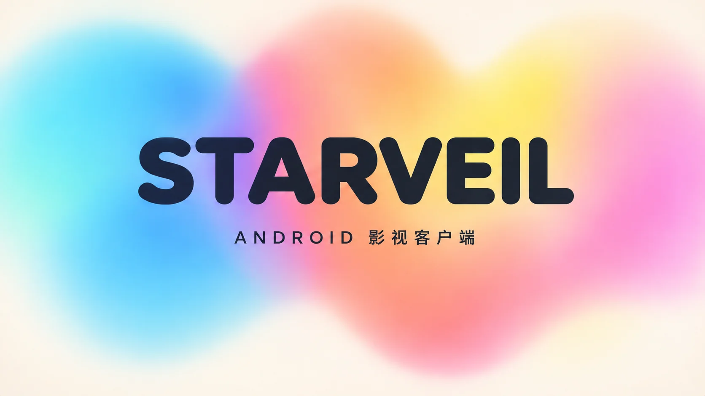

<p align="center">
  
</p>

<h1><b>星幕 Starveil</b></h1>

苹果 CMS V10 影视站点的 Android 客户端，配套一个 PHP 插件提供接口层。

**本项目只提供技术实现，不提供任何视频内容、内容源或可运营的服务端。** 使用前请先读 [DISCLAIMER.md](DISCLAIMER.md)。

---

## 它是什么

两个可以独立部署、通过固定契约通信的部分：

| 部分 | 技术栈 | 位置 | 规模 |
|---|---|---|---|
| Android 客户端 | Kotlin / Compose / Media3 / Retrofit | `app/` `core/` `feature/` | 约 27,000 行 Kotlin，17 个 Gradle 模块 |
| 苹果 CMS 插件 | PHP 8.1+ / ThinkPHP 5.0.24 | `server/starveilapi/` | 约 13,500 行 PHP，29 张 `cuican_*` 表 |

插件不改苹果 CMS 核心文件，全部数据表独立前缀，随核心升级不受影响。客户端按 `{code,msg,data}` 响应壳调用 `/icciu_api.php/v1.*` 接口。

## 它不包含什么

这一点比功能列表重要，因为它决定你拿过去能做什么、不能做什么：

- **不含任何影片数据、分类数据、播放地址。** 内容由你自己的苹果 CMS 内容库提供。
- **不含采集功能。** 插件代码里没有任何抓取第三方站点的逻辑（唯一的对外请求是拉 m3u / txt 直播列表和发短信验证码）。采集是苹果 CMS V10 自带的后台功能，与本仓库无关。
- **不含任何服务端地址。** 客户端要连哪个站，由构建时的配置决定，仓库里没有内置默认域名。
- **不含任何密钥。** 支付商户号、短信网关、广告 SDK key、SSV 密钥全部走后台配置或环境变量。
- **不含广告位。** 广告平台账号、广告位 ID 需要你自己申请并在后台填写。
- **不含用户数据。** 没有任何种子账号、测试凭据或导出数据。

## 项目特殊性

如果你打算接手或二次开发，这几条不读会踩坑：

1. **双端同时演进，契约是唯一纽带。** 客户端与插件不在同一个进程里，也没有共享 schema。改字段名、改响应结构必须两端同时改，否则运行时静默降级（`@JsonNames` 只覆盖少数字段）。接口契约见 `server/starveilapi/README.md` §3 与 `docs/api-usage.md`。

2. **`apikey` / `keytime` 不是安全机制。** 后端不校验这两个参数，客户端仍按契约携带只是为了兼容其它实现。真正的鉴权靠服务端 cookie 会话与 `Kernel::ROUTES` 路由白名单。**不要**把它当成防刷/防盗链手段。

3. **插件跑在 ThinkPHP 5.0.24 上，这是一个 2017 年的内核。** `think\Error::appError` 会把超过 `error_reporting` 阈值的警告直接抛成 `ErrorException`——PHP 8.2+ 的动态属性弃用会让插件白页而不是写日志。升级 PHP 前必须屏蔽 `E_DEPRECATED`。

4. **`count()` 和 `select()` 必须用两个独立构建的 Query。** ThinkPHP 5.0 的 `clone` 一个 Query 再 `count()` 会污染参数绑定，之后的主查询必报 `Invalid parameter number`。分页统计要抽个 helper 重建对象。

5. **`mac_user.group_id` 是 varchar 逗号串**（`"1,3"`），不是整型。会员判定必须按逗号列表处理，`(int)` 强转会漏。

6. **后台设置项互相影响。** `trysee_status`、`member_enabled`、`bottom_tabs` 之类加开关时，要同步考虑底栏与 Tab 的自动隐藏和恢复；多选类字段必须在 `Actions.php` 的 `SELECT_SETTINGS` / `MULTI_SETTINGS` 里登记，否则会渲染成文本框、存成空串、客户端回落到默认值——"后台选了没生效"多半是这个。

7. **客户端的配置有进程内缓存**（`DefaultStartupRepository.cachedDto`）。改完后台必须强杀进程重启才生效，切后台再回来不会重拉。

## 快速开始

### 客户端

需要 JDK 17、Android Studio 最新稳定版。

**本项目不发布预编译 APK。** 站点地址在编译期注入，每个人的后端不一样，所以必须自己打包——release workflow 也是因此不做。打包方法见下。

```bash
git clone <repo>
cd starveil-android
./gradlew :app:assembleDebug
```

构建前必须配置你的站点地址（见下面的已知阻塞项）。提交前跑闸门：

```bash
./gradlew check
```

它聚合编译、单元测试、Android Lint、detekt 和四道规范闸门（文件行数、颜色令牌、依赖方向、安全基线）。Windows 上内存吃紧可加 `--max-workers=1`。

### 插件

需要 PHP 8.1+、MySQL 5.7+（utf8mb4，8.0 未实测）、苹果 CMS V10。

1. `server/starveilapi/` 整个放进站点 `addons/starveilapi/`
2. `server/icciu_api.php` 放到站点根（与 `index.php` 同级）
3. 后台「应用 → 插件」启用，自动建 26 张表、写默认配置、生成会话密钥
4. 配置项、路由、Nginx/Apache 的 `PATH_INFO` 重写、后台菜单挂载、升级与卸载方式，**全部**在 [`server/starveilapi/README.md`](server/starveilapi/README.md)

插件目录名必须是 `starveilapi`，与 `info.ini` 的 `name` 和类名 `Starveilapi` 三者一致，否则自动加载找不到类。

## 已知阻塞项

这些是真实的未完成项，不要以为克隆下来就能上线：

- **站点地址靠 `local.properties` 的 `starveil.apiHost` 注入**（`app/build.gradle.kts` 的 `resValue`）。没配这个键时用占位地址 `https://api.example.com`，构建能过但连不上任何后端——**第一次构建前先填自己的域名**。
- **`apikey` 未在服务端校验**，见上文特殊性第 2 条。
- **支付只实测了易支付（Epay）**，微信/支付宝原生参数未接。
- **数据库只在 MySQL 5.7.40 上跑过**，8.0 未测；也没有压测与并发下单测试。
- **短剧广告 SSV 接口已就绪，但客户端 `AdGateway` 仍是 Noop**，需要你接入真实广告平台后才能真正解锁。

## 社区

- **Telegram 群组**：https://t.me/+vLgkzhHZ9c44YzA1
- **问题反馈**：[GitHub Issues](https://github.com/RemotePinee/Starveil/issues)

除上面这个链接外，本项目没有其它 Telegram 群、微信群或 QQ 群。
任何以本项目名义建立的其它群组都与作者无关。

## 文档

| 文件 | 内容 |
|---|---|
| [DISCLAIMER.md](DISCLAIMER.md) | 使用限制与免责声明，**部署前必读** |
| [AGENTS.md](AGENTS.md) | 工程硬约束（模块依赖、文件规模、颜色令牌、禁止清单） |
| [docs/api-usage.md](docs/api-usage.md) | 客户端接口清单：插件接口 / macCMS 原生接口 / 未接的路径 |
| [docs/security.md](docs/security.md) | 安全基线，含必须服务端整改的 6 项 |
| [docs/testing.md](docs/testing.md) | 测试策略 |
| [docs/design-system.md](docs/design-system.md) | 设计令牌 |
| [docs/code-standards.md](docs/code-standards.md) | 代码规范 |
| [docs/hongguo.md](docs/hongguo.md) | 红果短剧加密链路的技术说明（只讲结构与原理，不含实现） |
| [server/starveilapi/README.md](server/starveilapi/README.md) | 插件安装、接口清单、表结构、部署 |

## 授权

本项目以 **[PolyForm Noncommercial License 1.0.0](LICENSE)** 发布。

- **允许**：任何非商业目的的使用、修改与分发，包括个人学习、研究、实验、业余项目，以及慈善机构、教育机构、公共研究机构、公共安全与卫生机构、环保组织、政府机构的使用（不论其经费来源）。
- **需要单独授权**：任何商业用途。包括但不限于以本项目或其修改版对外提供付费、带广告或代运营的服务，销售，随商业产品分发，企业内部经营性使用。
- **必须保留**：分发时须一并提供本许可证全文或其 URL，以及 `Required Notice` 版权行。见 LICENSE 的 Notices 一节。

**这不是 OSI 认证的开源许可证，属于 source-available（源码公开）。** GitHub 等平台的 "Open Source" 标签不适用，请按 "Source Available" 描述本项目。

商业授权、定制与技术支持：通过仓库 issue 联系，标题注明 `[commercial]`。

**许可证只约束代码本身的著作权，不构成对任何内容、数据或运营行为的授权**，用途与责任边界见 [DISCLAIMER.md](DISCLAIMER.md)。

---

## 免责声明摘要

完整条款见 [DISCLAIMER.md](DISCLAIMER.md)。摘要不替代全文。

- 本项目是技术工具，**不附带任何内容授权**。用它搭站播放什么，由你决定，也由你负责。
- **采集他人影视内容并公开传播，属于实施信息网络传播行为**，未获权利人许可即侵权，与是否使用本项目无关。本项目不提供采集功能，也不为这类用途提供支持。
- 在中国大陆以影视点播对外提供服务，需要 ICP 备案、《信息网络传播视听节目许可证》等资质。**这些资质对个人与普通民营主体基本不可得**，请先确认自己具备再谈技术部署。
- 免责声明**不能**免除使用者自身的侵权责任。它划清的是作者与使用者之间的责任边界，不是使用者的护身符。
- 作者不对任何人使用本项目的后果承担责任，也不对任何特定用途作出适用性担保。

如你代表权利人认为本仓库内容侵犯权益，见 DISCLAIMER.md 末尾的联系方式。

## 友情链接

- [LINUX DO - 新的理想型社区](https://linux.do/)

